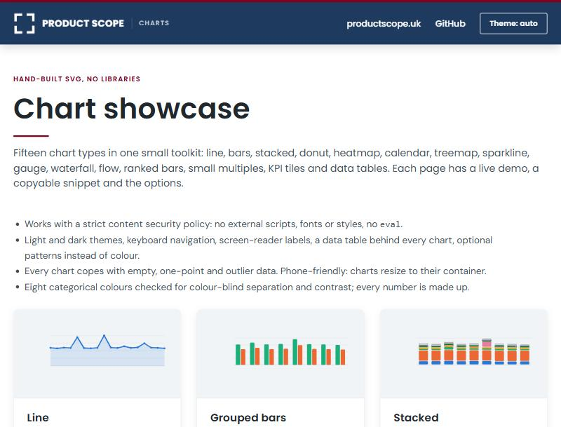

# Product Scope Charts

**Fifteen hand-built SVG chart types. No libraries, no dependencies, strict-CSP friendly, free to use.**

[**See it live**](https://charts.productscope.uk) · [Get the code](https://charts.productscope.uk/toolkit) · [Product Scope](https://productscope.uk)

[](https://charts.productscope.uk)

Every chart has its own page with a live demo, a copyable snippet and the options. All the data is made up (seeded random numbers generated in the browser), so there is nothing private in here.

## Why it exists

Most charting libraries want to inject scripts, styles and fonts, which fights a strict Content-Security-Policy, and accessibility tends to arrive as an afterthought. This toolkit is one stylesheet and one script. It draws plain SVG, and keyboard access, screen-reader labels and a colour-blind-checked palette are part of every chart rather than an add-on.

It started life inside one of our own apps. We cleaned it up and gave it away as a free resource.

## What you get

- **Fifteen chart types:** line, grouped bars, stacked, donut, heatmap, calendar, treemap, sparkline, gauge, waterfall, flow, ranked bars, small multiples, KPI tiles and data tables.
- **Works under a strict CSP:** no external scripts, fonts or styles, and no `eval`.
- **Accessible by default:** keyboard navigation, screen-reader labels, a data table behind every chart, and optional patterns instead of colour.
- **Honest about edge cases:** empty, one-point and outlier data are handled and shown, not hidden.
- **A mock-up dashboard** ([`/dashboard`](https://charts.productscope.uk/dashboard)) that puts ten of the chart types together in one made-up product view.
- **Light and dark themes**, and charts resize to their container, so they work on a phone.
- **Eight categorical colours**, checked for colour-blind separation and contrast. Contrast is below 3:1 for three of the eight, which is covered by legends, tooltips and the data-table view on every chart.

## Use it in your own project

1. **Copy it.** [charts.productscope.uk/toolkit](https://charts.productscope.uk/toolkit) has the design tokens, three small helpers, one block of CSS and one script. Paste them in and call the chart functions.
2. **Or fork this repo** and start from `src/charts.ts`.

Two things to know: the script is stored as a template literal in the source, so it contains no backticks and no dollar-brace sequences (keep it that way if you embed it the same way), and currency is hard-coded to pounds in `compact()` and `money0`, so change those two for another currency.

## Run it locally

```
npm install
npm run dev        # http://127.0.0.1:8787 (no Cloudflare login needed)
```

To deploy your own copy to Cloudflare, run `npx wrangler deploy` against your own account. (Product Scope maintainers use `npm run deploy:productscope`.)

## What's in the repo

| File | What it does |
| --- | --- |
| `src/charts.ts` | The toolkit: `CHARTS_CSS` and `CHARTS_JS`. |
| `src/shell.ts` | Design tokens (light and dark), the page chrome, the demo harness and the made-up data. |
| `src/pages.ts` | One entry per chart page: copy, snippet, options and the demo script. |
| `src/index.ts` | The Cloudflare Worker: routes, self-hosted fonts and a strict CSP with a per-request nonce. |
| `src/fonts/` | DM Sans and Poppins, self-hosted under the SIL Open Font License. See `src/fonts/README.md`. |

The site is served by a single Worker with no bindings and no secrets. The pages are generated on each request, so there is no build output to deploy.

## Made by Product Scope

[Product Scope](https://productscope.uk) is a product-led consultancy run by David Lortal. We help organisations improve how their systems, teams and processes work together, through product modernisation, automation, integration and AI-assisted delivery.

If you would like charts like these (or the dashboards and reporting around them) in your own product, or want to talk about something bigger, **[get in touch](https://productscope.uk/contact/)**. You can also read how we work in the [articles](https://productscope.uk/blog/).

## Feedback

Found a bug or an accessibility problem? Please [open an issue](https://github.com/DavidLortalPM/productscope-charts/issues). Pull requests for fixes are welcome; for a new chart type, open an issue first so we can talk it through.

## Licence

MIT. See [`LICENSE`](LICENSE). © 2026 David Lortal / Product Scope Ltd. Fonts are under the SIL Open Font License (see `src/fonts/README.md`).
